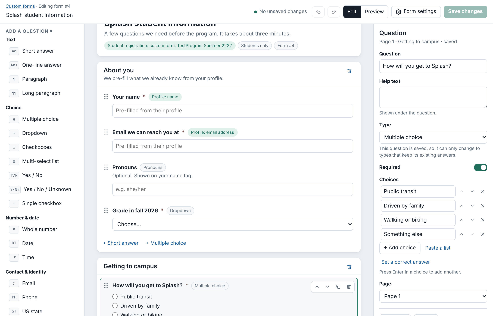
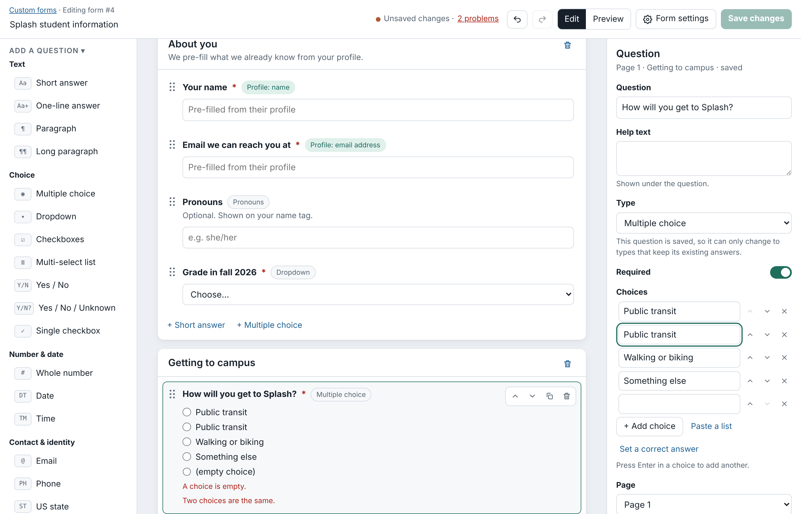
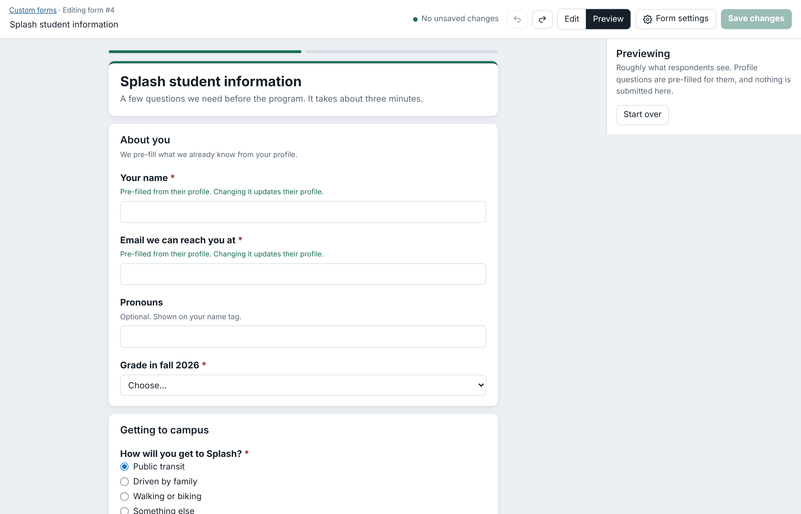
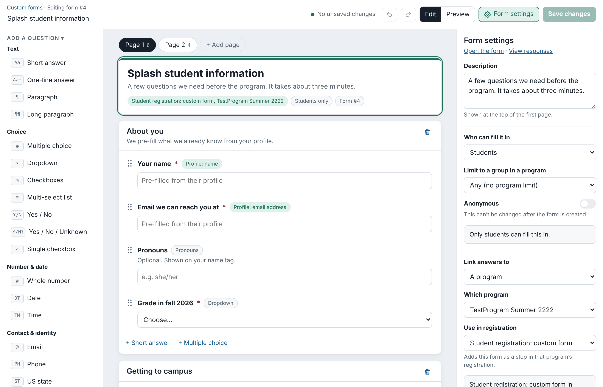

Custom Forms
============

Custom forms collect information that the rest of the site doesn't ask for, such as dietary restrictions, photo permission or a teacher logistics quiz. They are listed at /customforms/, where you can create, edit, fill in and see the responses to each form.

The form builder
----------------

Open /customforms/ and click the link to create a form, or click "Edit" next to an existing one. The builder has three columns:

- **Add a question** (left): click a question type to add it after the selected question, or drag it onto the page. The "Profile" groups are linked questions: they are pre-filled from the respondent's own profile, and their answer updates it.
- **The form** (middle): the form as respondents will see it, one page at a time. Click a question or section to edit it; drag questions to reorder them, or onto a page tab to move them to that page. The buttons on a question move it up or down, duplicate it or delete it.
- **Settings** (right): the settings for whatever is selected. Click "Form settings" in the top bar (or the form's title card) for the settings of the whole form.

Undo and Redo (Ctrl+Z and Ctrl+Shift+Z) work for every change, and nothing is saved until you click "Create form" or "Save changes" (Ctrl+S). The top bar lists any problems that would stop the form from saving, such as a question without a label, an empty section or two identical choices; click it to go to each one in turn.

"Preview" shows the form as respondents see it and checks answers the way the site will, including required questions, number ranges and correct answers. Nothing is submitted from the preview.

Form settings
-------------

- **Start from a copy of**: for a new form, copies the questions and settings of one of your existing forms. Saving creates a new form; the original is left alone.
- **Who can fill it in**: anyone logged in, or only teachers or students. You can also limit it to a group of teachers or students in one program, such as students enrolled in a class.
- **Anonymous**: responses aren't tied to an account. An anonymous form open to everyone can be filled in without logging in. Anonymous forms can't use profile questions, and this setting can't be changed once the form is created.
- **Link answers to**: ties each response to a program or class. Choose a particular one, or let respondents pick.
- **Use in registration**: for a form linked to a particular program, adds it as a step in that program's student or teacher registration (the Student Custom Form, Teacher Custom Form or Teacher Logistics Quiz module must be enabled for the program).
- **After submitting**: the thank-you message, and optionally a page to send respondents to next.

Correct answers
---------------

Most question types can have a correct answer, under "Answer checking" in the question's settings (for choices, click "Set a correct answer" and tick the right ones). Respondents must give that answer before they can continue. The teacher logistics quiz relies on this: when a form is used as a quiz, questions without a correct answer are marked on the form.

Editing a form that has responses
---------------------------------

Responses are stored in a table with one column per question, so some changes affect answers already given:

- Deleting a question deletes its answers when you save.
- A saved question can only change to a type that keeps its answers: a short answer can become a longer text type, multiple choice can become a dropdown (and back), and checkboxes can become a multi-select list (and back). To ask something a different way, add a new question and delete the old one.
- Changing what a form's answers are linked to deletes the program or class saved with each existing response.
