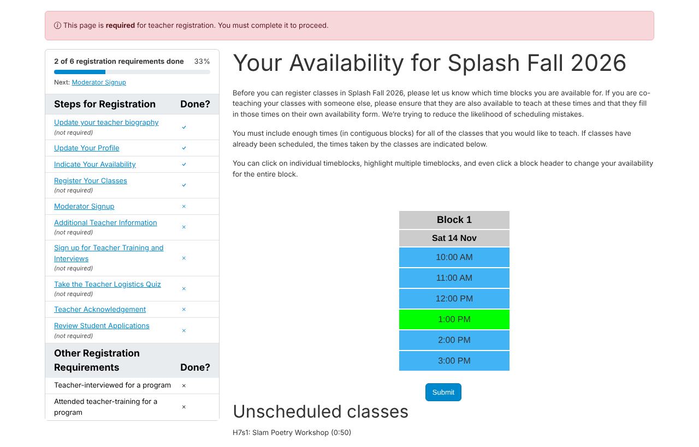
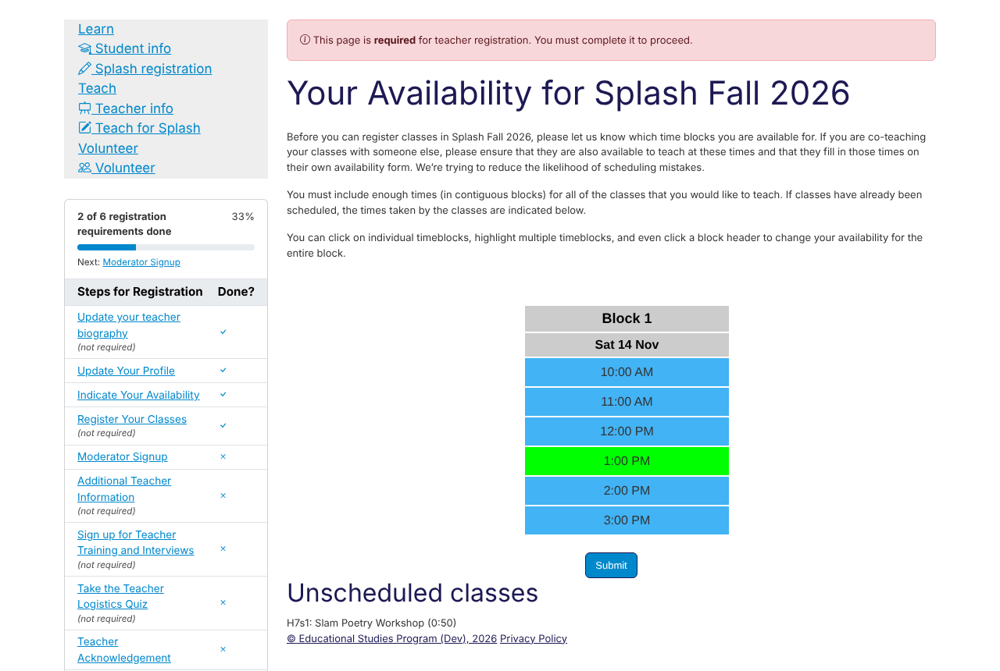
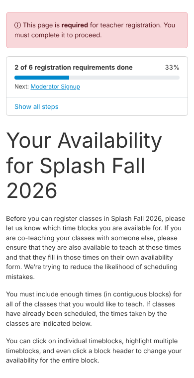
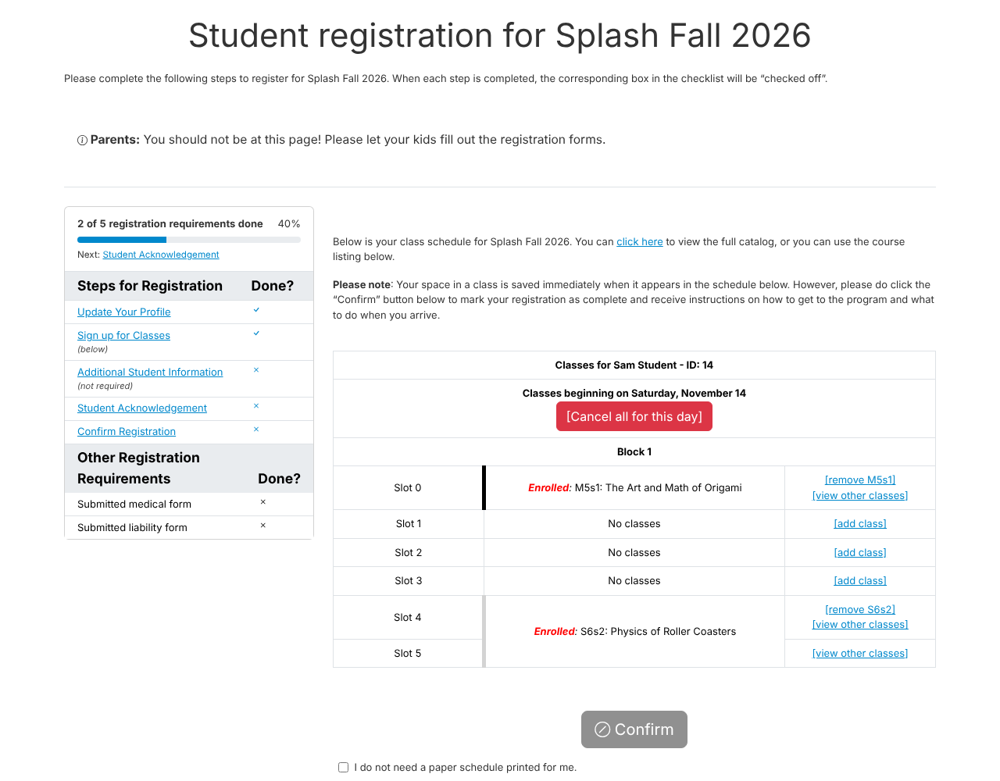

Refund Feature
==============

A new student refund feature provides administrators with the ability to instantly issue partial or full refunds directly through the website using the Stripe API. 

Administrators can navigate to the refunds page (linked under "Quick Links" in the management dashboard) and search for a student to view their transactions. The interface clearly displays the original transaction amount, how much has already been refunded, and the remaining amount available to refund. 

When a refund is submitted, it is processed synchronously via Stripe, and the results (success or failure) are shown on a confirmation screen. In either case, the CFO is sent an email indicating the status of the refund.

Teacher Schedule Deadline
=========================

A new ``Teacher/Classes/Schedule`` deadline controls whether teachers and moderators can see the room and time assigned to their sections on the teacher class registration page. While the deadline is closed, those assignments (along with the "Detailed Status" time blocks and the attendance links that go with them) are replaced with a note that the schedule is not yet available; everything else on the page is unchanged.

The deadline is created default-open for new programs, and is backfilled default-open for existing programs, so nothing changes until an administrator closes it. Close it while scheduling is in progress to keep teachers from seeing assignments that may still change, and re-open it when the schedule is final. Note that ``Teacher/All`` and ``Teacher/Classes/All`` imply this permission, so they must not be open at the same time for it to have any effect.

Registration Layout
===================

The student and teacher registration main pages and the pages of their registration steps (for students: profile, custom form, acknowledgement, extra costs, lunch selection, applications, medical forms, donations, payment and surveys; for teachers: profile, biography, availability, acknowledgement, moderator signup, teacher events, custom forms and quizzes, and surveys) now share the layout of the teacher registration main page. When the checklist is enabled, it (along with any other registration requirements) stays visible in a column beside the page content when the theme's content area is wide enough, or above the content otherwise (for example on phones and in the fruitsalad theme), so students and teachers can see their progress from any step. In the bigpicture theme, the list is instead shown in the theme's left sidebar, below the navigation links; this can be turned off with the new "Registration checklist in sidebar" theme setting, in which case the list is shown above the page content. The checklist now starts with a progress bar counting the required steps and other registration requirements that are done, and a link to the next one. While "Force show required modules" is on and a student or teacher still has required modules to finish, the steps in the checklist are not links, so the required modules are completed in order rather than skipped. Wherever the checklist is shown above the page content, the list of steps starts collapsed behind a "Show all steps" button, so the page content stays near the top. Registration no longer uses the old image-based progress bar: the student and teacher "Progress mode" setting 2 (progress bar) now shows the same checklist as setting 1.

Pages that students and teachers open on purpose and then leave no longer show the checklist, so they have the full page width:

- for students, the class registration pages (picking a class for a time slot, class documents, the lottery and two-phase registration pages, and class change requests), the waitlist page, and the payment result pages;
- for teachers, the class registration form and the class pages opened from it or from the class list (class status, rosters, class documents, coteachers, catalog preview, attendance, copying a class and student application review).

Nothing about how the modules work has changed.

   Figure 1: Checklist beside the page content (droplets theme)

   Figure 2: Checklist in the bigpicture theme's sidebar

   Figure 3: Checklist collapsed above the page content on a phone

   Figure 4: Checklist on the student registration main page (droplets theme)

Bug Fixes
=========

- Director email addresses and outgoing "From" addresses now accept ``learningu.org`` at any subdomain depth. The rule previously allowed at most one subdomain label, so an address like ``info@a.b.learningu.org`` was rejected even though the director email help text has always described any valid subdomain as acceptable. This applies to the program creation and program settings forms, the ``director_email`` model validator, and the "From" address checks used by the comm panel and automated mail.

Developer Notes
===============

- Upgraded Django from 4.2.30 to 5.2.14 (LTS).
- Updated dependencies for Django 5.2 compatibility: ``django-debug-toolbar`` 5.1.0 → 5.2.0.
- Student and teacher registration step templates extend ``program/modules/module_base.html`` (content goes in the ``module_content`` block; the main pages also use ``module_header``), which now holds the shared registration layout. Registration pages without the checklist extend ``main.html`` directly instead: for teachers, the class registration form (``classedit.html``) and the class pages (``cannoteditclass.html``, ``class_docs.html``, ``class_status.html``, ``class_students.html``, ``coteachers.html``, ``listcopyclasses.html`` and ``section_attendance.html`` in ``teacherclassregmodule``, ``teacherpreviewmodule/catalogpreview.html``, and ``review.html``, ``roster.html`` and ``questions.html`` in ``teacherreviewapps``); for students, ``class_docs.html``, ``conflict_confirm.html`` and ``fillslot.html`` in ``studentclassregmodule``, the ``lotterystudentregmodule`` and ``studentregtwophase`` pages, ``classchangerequest.html``, ``studentregcore/waitlist.html``, ``creditcardmodule_stripe/success.html`` and ``failure.html``, and ``formstackappmodule/finaidapp.html``. The checklist context for the main pages and module pages comes from ``esp.program.modules.checklist.get_checklist_context``, and templates get it from the ``registration_checklist`` template tag, which replaces ``registration_progress`` (and ``program/modules/module_progress.html``). The ``teacherregcore-mainpage.css`` stylesheet was renamed to ``reg-layout.css``, and its ``teacher-reg-*`` classes to ``reg-*``. Themes can show the checklist in their own sidebar by adding a ``sidebar_extra`` block to their ``main.html`` and a ``checklist_in_sidebar`` field to their theme settings form, as bigpicture does.
